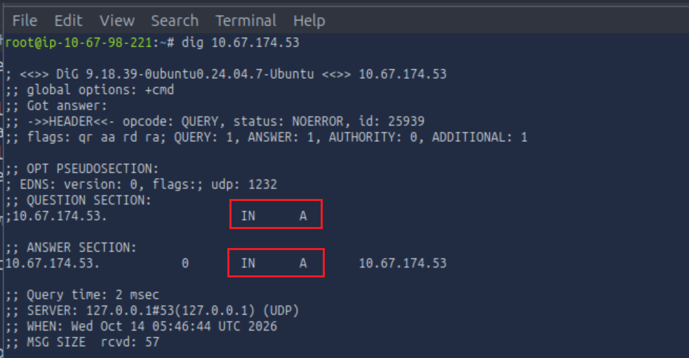
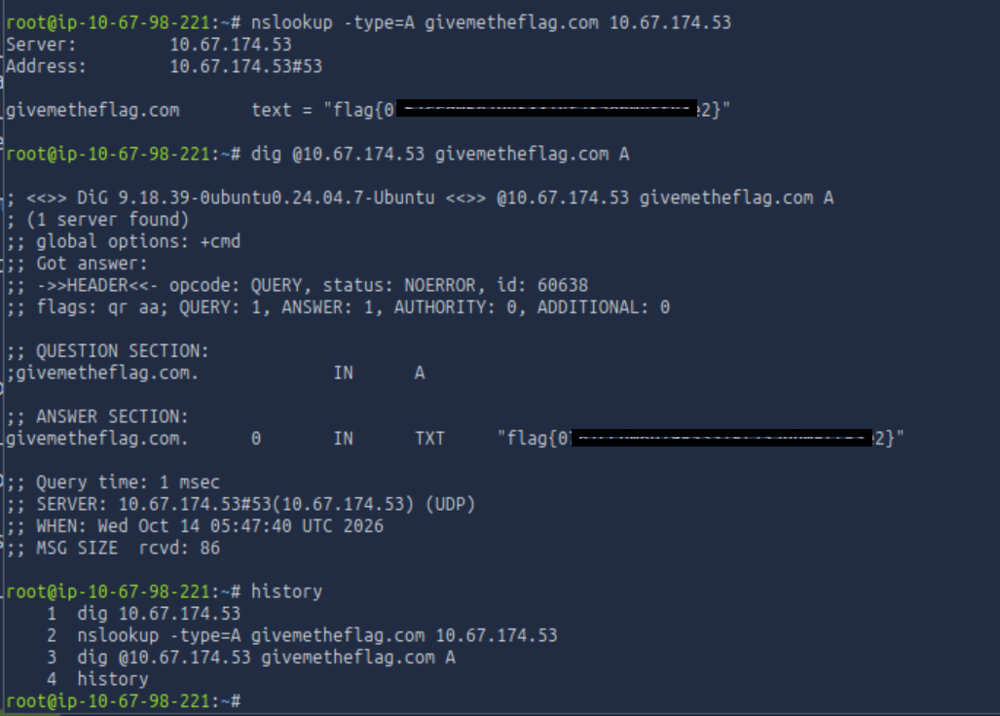

# Dig Dug


> Reto centrado en la enumeración DNS: consultar un servidor DNS con herramientas estándar para que devuelva información oculta.

## Resumen

<!-- 1 a 3 líneas: qué pide el reto y cómo se resolvió. -->
El desafío presentaba una máquina que actuaba como servidor DNS y solo respondía de forma especial a consultas sobre el dominio `givemetheflag.com`. Consultando directamente ese servidor con `nslookup` y `dig`, el servidor devolvió la flag dentro de un registro TXT.

## Objetivo

* Hacer que el servidor DNS de la máquina responda con la flag
* Practicar enumeración DNS con `dig` y `nslookup`

## Datos conocidos

<!-- Todo lo que el enunciado o el análisis inicial te da. -->

* La máquina objetivo es también un servidor DNS (puerto 53)
* Solo responde a una consulta especial para el dominio `givemetheflag.com`
* Hay que usar herramientas comunes de enumeración DNS de la AttackBox
* Entrada del reto: IP del servidor DNS (`10.67.174.53` en mi sesión) y el dominio `givemetheflag.com`

---

## Análisis

<!-- Explica tu razonamiento: qué hipótesis planteaste y por qué. -->

**Qué observé:** Lo único que tenía era la IP del servidor DNS y el dominio al que responde. Mi primer intento fue `dig 10.67.174.53`, pero eso consulta la IP como si fuera un nombre a través del resolvedor local de la AttackBox (`127.0.0.1`), no al servidor objetivo, así que solo devolvió un registro A de eco y no aportó nada útil.<br>

**Qué hipótesis formulé:** Si el servidor solo responde para `givemetheflag.com`, debo dirigir la consulta **a ese servidor** (no al resolvedor por defecto) y preguntar por ese dominio. Probé primero con el tipo A, que es el tipo de consulta básico.<br>

**Cómo la validé:** Con `nslookup -type=A givemetheflag.com 10.67.174.53` el servidor respondió con un registro de texto que contenía la flag. Repetí la consulta con `dig @10.67.174.53 givemetheflag.com A` y obtuve el mismo resultado, confirmando que la respuesta venía del servidor objetivo.

## Solución paso a paso

**1.** Identifiqué los datos disponibles: IP del servidor DNS y dominio `givemetheflag.com`.<br>
**2.** Descarté `dig <IP>` porque consultaba el resolvedor local y no el servidor objetivo.<br>
**3.** Consulté directamente al servidor objetivo con `nslookup`, indicando tipo de registro, dominio y servidor.<br>
**4.** Repetí la consulta con `dig @servidor dominio tipo` para comparar herramientas.<br>
**5.** Entregué la flag encontrada en la respuesta.<br>

```bash
# nslookup -type=TYPE DOMAIN_NAME [SERVER]
nslookup -type=A givemetheflag.com 10.67.174.53
```

```bash
# dig [@SERVER] DOMAIN_NAME [TYPE]
dig @10.67.174.53 givemetheflag.com A
```

**Resultado destacado:** aunque la consulta fue de tipo A, la sección ANSWER devolvió un registro `TXT` con la flag (`flag{REDACTED}`). Esa es la "respuesta especial" del servidor.

**Evidencia:**





---

## Qué intenté y no funcionó

* `dig 10.67.174.53`: consulté la IP como si fuera un dominio. Fue al resolvedor local (`127.0.0.1`) y devolvió un registro A de eco. Aprendí que sin `@servidor` la consulta no llega al DNS objetivo y que la IP no es el nombre que hay que preguntar.

## Técnica aprendida

<!-- Explica la idea general para que sirva en otros retos, no solo en este. -->
Para enumerar un servidor DNS concreto hay que dirigirle la consulta explícitamente (`@servidor` en `dig`, o el servidor como último argumento en `nslookup`) y preguntar por el dominio correcto. Además, un servidor puede responder con un tipo de registro distinto al solicitado (aquí TXT a una consulta A), así que conviene leer toda la sección ANSWER y probar varios tipos de registro.

Referencia rápida de sintaxis y tipos de registro comunes:

* `nslookup DOMAIN_NAME`: búsqueda simple con el resolvedor predeterminado.
* `nslookup -type=TYPE DOMAIN_NAME [SERVER]`: especifica tipo de registro y servidor DNS opcional.
* `dig [@SERVER] DOMAIN_NAME [TYPE]`: equivalente en `dig`, más detallado y preferido por muchos.

| Tipo | Resultado |
|---|---|
| A | Dirección(es) IPv4 del dominio |
| AAAA | Dirección(es) IPv6 del dominio |
| CNAME | Nombre canónico: alias que apunta un dominio a otro |
| MX | Servidores de correo responsables del dominio |
| SOA | Inicio de autoridad: servidor de nombres principal, correo del administrador y número de serie de la zona |
| TXT | Texto arbitrario, usado en SPF, DKIM, DMARC y verificación de dominio |

## Contexto defensivo

<!-- Por qué esta debilidad importa en un entorno real y cómo se evita. Elimina la sección si no aplica. -->
Los registros DNS, especialmente los TXT, suelen contener información sensible o útil para un atacante (políticas de correo, tokens de verificación, notas internas). Se recomienda no almacenar secretos ni datos internos en registros públicos, restringir las transferencias de zona, separar DNS interno y externo, y monitorizar consultas anómalas o de enumeración contra los servidores de nombres.

## Mapeo a MITRE ATT&CK

| ID | Técnica | Cómo se aplicó |
|---|---|---|
| T1590.002 | Gather Victim Network Information: DNS | Consulta directa al servidor DNS con `nslookup` y `dig` para obtener registros del dominio |

## Lecciones aprendidas y próximos pasos

**Qué funcionó:** Dirigir la consulta al servidor objetivo, comparar `nslookup` y `dig`, y leer con atención la sección ANSWER.<br>
**Qué mejoraría en mi proceso:** Probar de entrada varios tipos de registro (TXT, MX, SOA, `ANY`) en lugar de asumir el tipo, y revisar qué servidor responde antes de interpretar el resultado.<br>
**Retos relacionados para practicar:** Transferencias de zona (`dig axfr`), enumeración de subdominios y análisis de registros TXT (SPF, DKIM, DMARC).
